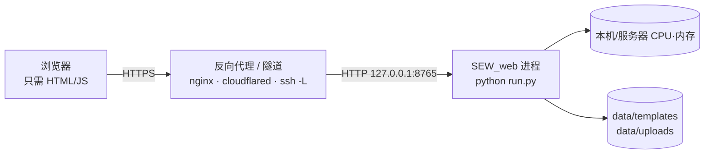

# 部署与在线访问（计算在本机，浏览器零环境）

SEW web 的架构本身就是「服务端跑 Python、浏览器只走 HTTP」，所以**不需要**在使用者电脑上
装任何 Python / astropy / ppxf。所谓「在线工具」= 把服务跑在有算力的机器上，再让浏览器能
访问到它。



---

## 1. 放到 GitHub

```bash
cd /home/jflu/SEW_web
git init -b main          # 若已 init 可跳过
git add .
git commit -m "SEW web: FITS spectrum / cube viewer & fitter"

# 用你自己的仓库地址（先在 GitHub 上建空仓库，不要勾选 README/.gitignore）
git remote add origin git@github.com:<你的账号>/sew-web.git
git push -u origin main
```

> 仓库里**不要**提交数据：`.gitignore` 已排除 `data/uploads/`、`data/templates/`、
> `*.log`、`__pycache__`。模板 npz 动辄几百 MB，走页面「模板库 → 从 URL 下载」即可。

CI：`.github/workflows/ci.yml` 会做 Python 语法检查、JS 语法检查、i18n 键一致性校验，
并在 push 时构建一次 Docker 镜像。

---

## 2. 让别人（或自己在外面）用浏览器访问

### 方式 A：SSH 端口转发（最安全，零公网暴露）

在**自己电脑**上：

```bash
ssh -N -L 8765:127.0.0.1:8765 <user>@<服务器地址>
```

然后浏览器打开 `http://127.0.0.1:8765/`。全程走 SSH 加密，不需要额外认证，
也不会把服务暴露到公网。适合个人/小团队。

### 方式 B：Cloudflare Tunnel（免费、临时公网域名）

在跑服务的机器上：

```bash
# 安装 cloudflared 后
cloudflared tunnel --url http://127.0.0.1:8765
```

会得到一个 `https://xxx.trycloudflare.com` 地址，任何人拿到链接就能访问。
**必须**同时开启认证与路径白名单（见第 3 节）。

### 方式 C：服务器 + nginx + TLS（长期使用）

```bash
# 服务器上
SEW_AUTH='user:强密码' SEW_DATA_ROOTS='/data:/home/user/fits' \
  python run.py --host 127.0.0.1 --port 8765
```

nginx 片段：

```nginx
server {
    listen 443 ssl http2;
    server_name sew.example.com;
    client_max_body_size 4g;          # 与后端 MAX_CONTENT_LENGTH 一致

    location / {
        proxy_pass http://127.0.0.1:8765;
        proxy_read_timeout 600s;      # 拟合/分 bin 可能跑很久
        proxy_request_buffering off;  # 大文件上传
    }
}
```

> 也可以用 Tailscale / ZeroTier 组虚拟内网，把它当内网服务访问，安全性接近方式 A。

---

## 3. 对外暴露前必须做的三件事

| 设置 | 作用 | 示例 |
|---|---|---|
| `SEW_AUTH` | HTTP Basic 认证（所有路由，含图片/下载） | `SEW_AUTH='alice:长随机密码'` |
| `SEW_DATA_ROOTS` | 只允许这些目录里的 FITS 被打开/浏览（`os.pathsep` 分隔） | `SEW_DATA_ROOTS=/data:/home/alice/fits` |
| TLS | 公网必须走 HTTPS（否则密码明文） | nginx / cloudflared / tailscale |

说明：

- 不设 `SEW_AUTH` 时是**无认证**状态（本地单用户工具的默认值）。用
  `--host 0.0.0.0` 直接暴露在公网 **等于把服务器的文件浏览器开放给所有人**，
  因为 `/api/browse` 能列目录、`/api/open` 能打开任意路径。
- 设了 `SEW_DATA_ROOTS` 后，浏览只能从白名单第一个目录开始，`..` 之类也出不去；
  上传目录（`data/uploads`）始终允许。
- 上传上限 4 GB（`MAX_CONTENT_LENGTH`），nginx 侧记得同步 `client_max_body_size`。
- 拟合是 CPU 密集型：单实例默认 `OMP_NUM_THREADS=1`，多个用户同时拟合会排队
  （后端已用 `fit_lock` 串行化）。人多时建议多副本 + 前置负载均衡，或限制并发。

---

## 4. 常见问题

**Q：能不能直接「点开 GitHub Pages 就能用」？**
不能。GitHub Pages 只托管静态文件，而这里需要跑 ppxf/astropy 的 Python 进程。
GitHub 只用来放代码；计算必须在有 CPU 的机器上（你的工作站、服务器、或云主机）。

**Q：能不能免费跑在 GitHub Actions 上？**
理论可行（每次请求触发一次 job），但单次上限 6 小时、无状态、启动即拉镜像，
交互式拟合完全不合适，不建议。

**Q：数据会不会上传到 GitHub / 第三方？**
不会。除非你自己把 FITS 提交进仓库，或数据放在云主机上。用方式 A（SSH 转发）时
数据始终在你自己的机器上，只在本机浏览器和本机进程之间流动。

**Q：想给别人一个「试用」链接但不想暴露文件系统？**
用方式 A 或 C，并设置 `SEW_DATA_ROOTS` 指向一个只放示例数据的目录
（例如 `/data/demo`），对方就只能看那里的文件。
